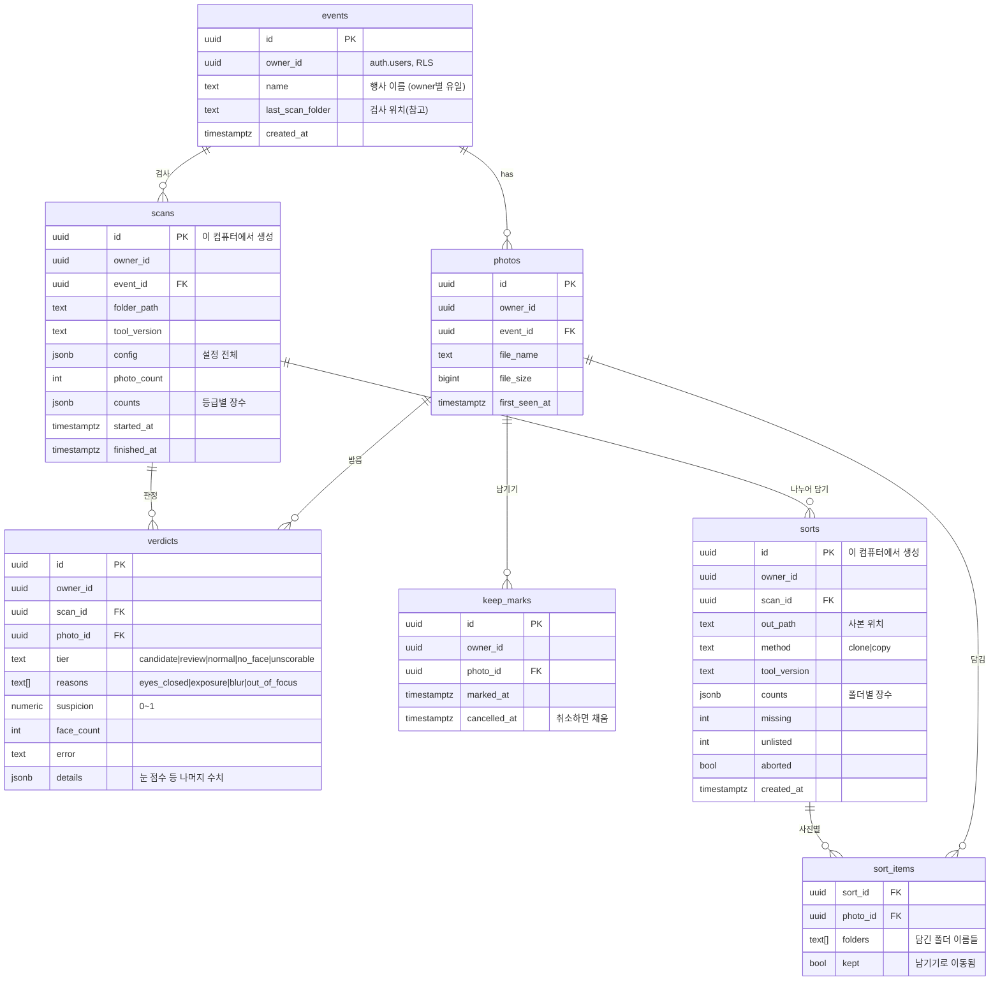

# bcut 데이터베이스 기획 (슈파베이스) — 초안

> **로그인 설계를 포함한 최신 ERD는 `erd.md`를 따른다(`profiles` 테이블과 소유 관계 추가, ADR-0006).**
>
> **셀렉 훑기 모드 기획(2026-10-20)으로 `keep_marks`가 `photo_marks`로, `review_sessions`가 추가될 예정이다. 적용 전이며 상세는 `erd.md`의 "적용 대기 변경"을 따른다.**
>
> 상태: 인터뷰 확정 사항을 정리한 **기획서**이며, 아직 구현·마이그레이션·슈파베이스 프로젝트 생성 전이다. 용어는 `GLOSSARY.md`, 결정 근거는 `docs/adr/0001~0005`를 따른다.

## 1. 확정된 결정 (인터뷰 Q1~Q20)

| # | 결정 |
| --- | --- |
| Q1 | 사진·썸네일은 로컬에만. 슈파베이스에는 검사 결과(메타데이터)만 |
| Q2 | 파일 이름·행사 이름이 올라가는 것은 승인 (대신 로그인·RLS 필수) |
| Q3 | 이메일 로그인 계정 1개 + 모든 테이블 RLS (비밀 키 방식 제외) |
| Q4·Q14 | 검사는 오프라인 가능, 저장은 "올릴 대기 목록"(로컬)에 쌓았다가 연결되면 자동 업로드. 로컬 CSV는 계속 남김 |
| Q5 | 슈파베이스 통신은 로컬 서버의 새 파일 하나에서만. 앱 창은 지금처럼 외부 요청 차단 |
| Q6 | 검사 한 번마다 기록을 따로 쌓음(덮어쓰지 않음) |
| Q7 | 이전 범위: 행사, 검사·판정, 남기기, 나누어 담기 기록. **제외:** Capture One 기록, 홀드아웃 라벨 |
| Q8 | 기존 CSV(EVENT_A 400, EVENT_B 145 등)는 1회 가져오기. **홀드아웃 560장은 가져오지 않음** |
| Q9 | 사진 = 행사 + 파일 이름 + 파일 크기 |
| Q10 | 행사 = 사용자가 붙인 행사 이름(기본: 폴더 이름). 폴더 경로는 "검사 위치"(참고용) |
| Q11 | 자주 쓰는 값은 별도 열, 나머지 상세 수치는 JSON 한 열 |
| Q12 | 남기기는 "행사의 사진"에 붙음 → 재검사해도 유지 |
| Q13 | 나누어 담기: 요약 + 사진별 담긴 폴더 모두 저장 |
| Q15 | 이번엔 DB 구조까지. 새 화면은 다음 단계 (단 시작 화면의 "최근 검사 목록"을 읽을 수 있게 설계) |
| Q16 | 지우는 기능 없음, 삭제 권한 없음. 틀린 기록은 "취소됨" 표시 |
| Q17 | 검사·나누어 담기 번호(UUID)는 이 컴퓨터에서 생성 → 중복 업로드 방지 |
| Q18 | 검사마다 도구 버전 + 설정 전체 내용 저장 |
| Q19 | 무료 플랜 시작(1500장 1회 ≈ 1.5MB, 월 45MB 추정). 일시 정지 시 대기 목록에 쌓임 |
| Q20 | 판정 한 건에 문제 종류 여러 개 가능 |

## 2. ERD

핵심 제약:
- `photos`: unique(event_id, file_name, file_size)
- `verdicts`: unique(scan_id, photo_id)
- `keep_marks`: 사진당 "취소 안 된" 행은 하나만 (부분 유일 인덱스 `where cancelled_at is null`)
- `sort_items`: PK(sort_id, photo_id)
- `events`: unique(owner_id, name)

## 3. 접근 제한 (RLS)
- 모든 테이블에 `owner_id = auth.uid()`인 행만 읽기·쓰기(insert) 허용.
- **delete 정책 없음**(삭제 불가). update는 `keep_marks.cancelled_at`, `events.last_scan_folder`만 허용.
- 업로드는 같은 UUID면 무시(`on conflict do nothing`) — 이 규칙으로 오프라인 재전송이 안전하다.

## 4. 데이터 흐름 (로컬 ↔ 슈파베이스)
1. 검사 실행 → 로컬 CSV 생성(지금과 동일, 판정 코드 수정 없음).
2. 검사 완료 시 UUID 생성 → 행사/사진/검사/판정을 **올릴 대기 목록**(로컬 파일)에 기록.
3. 로컬 서버의 업로드 전용 파일이 인터넷이 되면 순서대로 올리고(행사 → 사진 → 검사 → 판정), 성공한 항목을 목록에서 뺀다.
4. 남기기·나누어 담기도 같은 경로로 올린다.
5. 시작 화면의 "최근 검사 목록"은 슈파베이스를 읽고, 안 되면 로컬 CSV로 대체.

## 5. 아직 열려 있는 것(구현 전에 정할 것)
- 슈파베이스 프로젝트·계정 생성은 사용자가 직접 한다(계정 만들기는 도구가 대신하지 않음). 접속 키(공개 anon 키가 아닌 로그인 방식)의 보관 위치(macOS 키체인 권장).
- 무료 플랜의 정확한 한도·일시 정지 조건은 구축 직전에 공식 문서로 재확인.
- 기존 CSV 가져오기 스크립트에서 `정리 기록.json`을 어떻게 `sort_items`로 바꿀지(과거 기록은 검사와 연결 못 하는 경우 처리).
- 안전 시험(`test_safety_rules.py`)에 예외 파일 하나를 추가하는 방식 — 구현 단계에서.
