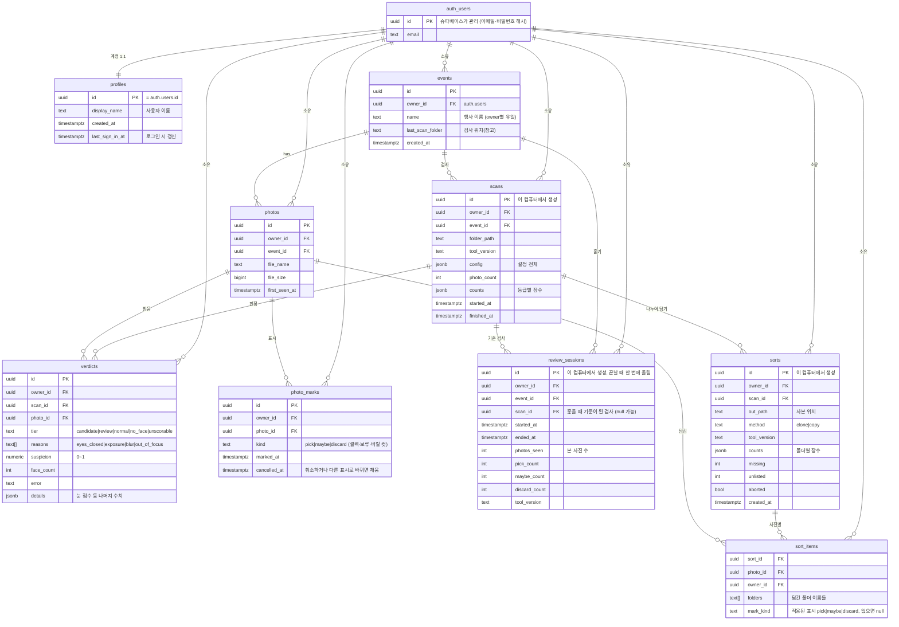

# bcut ERD (로그인 포함)

> 기획 상태. 근거: `docs/database-plan.md`, `docs/select-mode-plan.md`, `GLOSSARY.md`, `docs/adr/0001~0008`.
> 슈파베이스 DB(PostgreSQL)에 둘 테이블이다. 로컬 CSV·올릴 대기 목록은 DB 밖이다.
>
> **적용 상태 (2026-10-20):** 이 ERD가 **지금 슈파베이스에 적용된 구조**다. 셀렉 훑기 변경(`photo_marks`, `review_sessions`, `sort_items.mark_kind`)을 마이그레이션 `select_mode_marks_and_reviews`(파일: `supabase/migrations/20261020000200_select_mode_marks_and_reviews.sql`)로 **적용했다.** 적용 뒤 테이블 9개·접근 제한 켜짐·비로그인 읽기 불가·삭제 권한 없음을 조회로 확인했고, 임시 계정 시험 9개 항목(적용 후 전부 취소)이 통과했다. 데이터는 0건이다.

## 적용된 변경 (셀렉 훑기 모드, ADR-0007·0008, 2026-10-20 적용)

| 변경 | 이유 |
|---|---|
| `keep_marks` → **`photo_marks`**: `kind` 열(`pick` / `maybe` / `discard`) 추가. 취소되지 않은 표시는 사진당 하나 | 표시가 셀렉·보류·버릴 컷 세 가지가 되고 "남기기"는 없어졌다 |
| **`review_sessions`** 신규 | 훑기 한 번의 시간·본 사진 수·표시 수를 기록해 장당 훑는 시간을 잰다. `scan_id`는 비워 둘 수 있다(검사 기록 업로드와 순서가 엇갈려도 막히지 않게). 표시 수는 훑기를 마칠 때의 합계 |
| `sort_items.kept` → **`mark_kind`** (null 가능) | 나누어 담을 때 적용된 표시를 기록 (셀렉·보류 폴더) |
| `sorts.counts`(jsonb)에 셀렉·보류 장수 포함 | 열 추가 없음 |

## 제약
- `profiles.id`는 `auth.users.id`와 같다. 계정을 만들 때 함께 만든다(대시보드에서 계정 생성 후 한 줄 추가 또는 DB 트리거).
- `photos`: unique(event_id, file_name, file_size) · `verdicts`: unique(scan_id, photo_id)
- `events`: unique(owner_id, name) · `sort_items`: PK(sort_id, photo_id)
- `photo_marks`: 사진당 취소 안 된 행은 하나만 (부분 유일 인덱스 `where cancelled_at is null`). `kind`는 pick / maybe / discard만 허용(check)
- `review_sessions`: 추가만 가능. `photos_seen`·`*_count`는 0 이상, `ended_at`은 `started_at` 이후
- 새 표시를 달 때: 앞의 활성 표시의 `cancelled_at`을 채우고 새 행을 추가한다 (삭제하지 않음)

## 로그인 설계 (ADR-0006)
| 항목 | 결정 |
| --- | --- |
| 방식 | 이메일 + 비밀번호만 |
| 가입 | 앱에 가입 화면 없음. 슈파베이스에서 공개 가입을 막고 계정은 대시보드에서 직접 생성 |
| 로그인 요청 | 앱 창이 아닌 로컬 서버(슈파베이스 통신 전용 파일)가 보냄 |
| 상태 유지 | 한 번 로그인하면 유지. 토큰은 macOS 키체인(Electron `safeStorage`)에 암호화 저장, 브라우저 저장소·평문 파일 금지 |
| 로그인 안 했을 때 | 검사·훑기·표시·나누어 담기는 로컬에서 정상 동작, 올리기만 "올릴 대기 목록"에 대기 |
| 비밀번호 분실 | 앱 기능 없음, 슈파베이스 대시보드에서 직접 재설정 |
| 접속 기록 | 별도 테이블 없음, `profiles.last_sign_in_at`만 갱신 |

## 접근 제한 (RLS)
- 모든 테이블: `owner_id = auth.uid()`인 행만 읽기·insert 허용. `profiles`는 `id = auth.uid()`.
- delete 정책 없음. update 허용: `photo_marks.cancelled_at`, `events.last_scan_folder`, `profiles.display_name·last_sign_in_at`.
- 업로드는 같은 UUID면 무시(`on conflict do nothing`).
- `review_sessions`: 읽기·추가만 허용(수정·삭제 없음).
