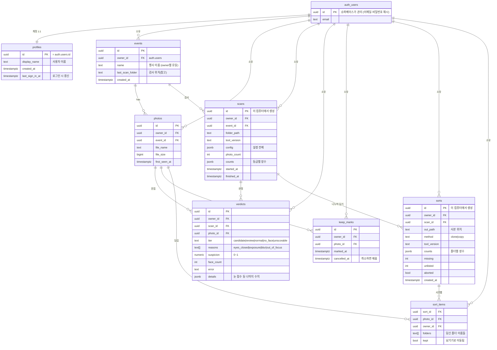

# bcut ERD (로그인 포함)

> 기획 상태. 근거: `docs/database-plan.md`, `GLOSSARY.md`, `docs/adr/0001~0006`.
> 슈파베이스 DB(PostgreSQL)에 둘 테이블이다. 로컬 CSV·올릴 대기 목록은 DB 밖이다.

## 제약
- `profiles.id`는 `auth.users.id`와 같다. 계정을 만들 때 함께 만든다(대시보드에서 계정 생성 후 한 줄 추가 또는 DB 트리거).
- `photos`: unique(event_id, file_name, file_size) · `verdicts`: unique(scan_id, photo_id)
- `events`: unique(owner_id, name) · `sort_items`: PK(sort_id, photo_id)
- `keep_marks`: 사진당 취소 안 된 행은 하나만 (부분 유일 인덱스 `where cancelled_at is null`)

## 로그인 설계 (ADR-0006)
| 항목 | 결정 |
| --- | --- |
| 방식 | 이메일 + 비밀번호만 |
| 가입 | 앱에 가입 화면 없음. 슈파베이스에서 공개 가입을 막고 계정은 대시보드에서 직접 생성 |
| 로그인 요청 | 앱 창이 아닌 로컬 서버(슈파베이스 통신 전용 파일)가 보냄 |
| 상태 유지 | 한 번 로그인하면 유지. 토큰은 macOS 키체인(Electron `safeStorage`)에 암호화 저장, 브라우저 저장소·평문 파일 금지 |
| 로그인 안 했을 때 | 검사·남기기·나누어 담기는 로컬에서 정상 동작, 올리기만 "올릴 대기 목록"에 대기 |
| 비밀번호 분실 | 앱 기능 없음, 슈파베이스 대시보드에서 직접 재설정 |
| 접속 기록 | 별도 테이블 없음, `profiles.last_sign_in_at`만 갱신 |

## 접근 제한 (RLS)
- 모든 테이블: `owner_id = auth.uid()`인 행만 읽기·insert 허용. `profiles`는 `id = auth.uid()`.
- delete 정책 없음. update 허용: `keep_marks.cancelled_at`, `events.last_scan_folder`, `profiles.display_name·last_sign_in_at`.
- 업로드는 같은 UUID면 무시(`on conflict do nothing`).
